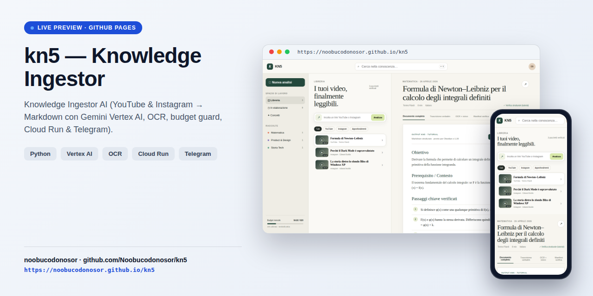

# kn5 — Knowledge Ingestor

[](https://noobucodonosor.github.io/kn5/)

**Anteprima Interattiva Live (GitHub Pages):** [https://noobucodonosor.github.io/kn5/](https://noobucodonosor.github.io/kn5/)

Trasforma **Reel / post / caroselli Instagram** e **video YouTube** in note
markdown dense e navigabili (Obsidian-friendly), analizzate da **Gemini** su
Google Vertex AI: sintesi, fasi del processo, concetti chiave, **trascrizione
verbatim** dell'audio e **OCR** del testo on-screen.

Ogni contenuto diventa un file `.md` con frontmatter YAML completo, archiviato
in una **biblioteca** per profilo. Una **sentinella di budget** stima il costo
di ogni chiamata Gemini e blocca la spesa oltre un tetto mensile.

---

## Indice

- [Cosa fa](#cosa-fa)
- [Architettura](#architettura)
- [Prerequisiti](#prerequisiti)
- [Installazione](#installazione)
- [Configurazione](#configurazione)
- [Uso](#uso)
  - [1. CLI — un singolo link](#1-cli--un-singolo-link)
  - [2. Bulk — un intero profilo/canale](#2-bulk--un-intero-profilocanale)
  - [3. Bot Telegram + dashboard web](#3-bot-telegram--dashboard-web)
  - [4. Deploy in cloud (sempre online)](#4-deploy-in-cloud-sempre-online)
- [Autenticazione Instagram](#autenticazione-instagram)
- [La biblioteca](#la-biblioteca)
- [Budget e costi](#budget-e-costi)
- [Troubleshooting](#troubleshooting)
- [Struttura del progetto](#struttura-del-progetto)

---

## Cosa fa

Dai un URL (o un intero profilo), e per ogni contenuto kn5:

1. **Scarica** il media — video via `yt-dlp`, caroselli/immagini via `gallery-dl`.
2. **Estrae i metadata** — caption, hashtag, autore, data, like/view/commenti.
3. **Analizza con Gemini** (Vertex AI) producendo uno schema strutturato:
   titolo, sintesi, fasi, insight, trascrizione verbatim, OCR, descrizione visiva, tag.
4. **Registra il costo** stimato nel budget tracker mensile.
5. **Salva** un markdown ricco in `library/profiles/<profilo>/`.

Nei job web, ogni segmento completato viene salvato come checkpoint su GCS. Se
Gemini o Cloud Run hanno un guasto temporaneo, Cloud Tasks riprende il job senza
rianalizzare né ricontabilizzare i segmenti già conclusi.

La verifica finale è dichiaratamente **strutturale**: controlla copertura dei
segmenti, presenza delle evidenze audio/visive e validità dei timestamp. Non
certifica automaticamente l'equivalenza semantica con la fonte, che rimane
indicata come `not_verified` nel risultato del job.

Quattro modi di usarlo: **CLI**, **bulk**, **bot Telegram + dashboard**, **cloud**.

Per valutare la qualità di pacchetti già generati contro i casi di riferimento:

```bash
make eval PACKAGES=/percorso/ai/pacchetti
```

Il gate automatico rileva omissioni e violazioni del contratto; l'equivalenza
funzionale richiede anche la rubrica di revisione umana in `evals/README.md`.

## Architettura

```
URL ─▶ MediaFetcher ─▶ KnowledgeSynthesizer ─▶ LibraryWriter ─▶ library/*.md
        (yt-dlp,          (Gemini/Vertex AI)      (markdown +
         gallery-dl)                                frontmatter)
                    ▲
              BudgetTracker  (sentinella: blocca prima di sforare il tetto mensile)
```

| Componente | File | Ruolo |
|---|---|---|
| `MediaFetcher` | `src/skills/media_fetcher.py` | download media + estrazione metadata |
| `KnowledgeSynthesizer` | `src/skills/knowledge_synthesizer.py` | analisi multimodale Gemini → schema `ProcessMap` |
| `LibraryWriter` | `src/skills/library_writer.py` | render markdown + indice per profilo |
| `LibraryBrowser` | `src/skills/library_browser.py` | lettura read-only per la dashboard |
| `BudgetTracker` | `src/skills/budget.py` | stima costi + gate di spesa mensile |
| `dashboard` | `src/skills/dashboard.py` | UI web (biblioteca, budget, scansione, report) |
| Entrypoint CLI | `main.py` | un singolo URL |
| Entrypoint bulk | `bulk_processor.py` | un intero profilo/canale |
| Entrypoint bot | `telegram_bot.py` | bot Telegram + server Flask |

## Prerequisiti

- **Python 3.11+** (testato su 3.11 in Docker e 3.14 in locale).
- **ffmpeg** nel PATH (estrazione audio dai video).
- **Un progetto Google Cloud** con **Vertex AI** abilitato e un **bucket GCS**.
- **Un service account** con ruoli `Vertex AI User` + `Storage Object Admin`
  (in locale: scarica la chiave JSON; in cloud: usato automaticamente da Cloud Run).
- Per il bot: un **token Telegram** da [@BotFather](https://t.me/BotFather).
- Per Instagram: un browser loggato su IG (locale) o cookie esportati (cloud).
- *(Opzionale)* un **token Apify** per scansionare l'elenco post di un profilo IG.

Installa ffmpeg:

```bash
# macOS
brew install ffmpeg
# Debian/Ubuntu
sudo apt-get install -y ffmpeg
```

## Installazione

```bash
git clone <repo> kn5 && cd kn5

# Ambiente virtuale + dipendenze (oppure: make setup)
python3 -m venv venv
./venv/bin/pip install -r requirements.txt

# Configurazione
cp .env.example .env
# poi apri .env e compila i valori (vedi sotto)
```

## Configurazione

Tutta la config passa dal file **`.env`** (mai committato). Parti da
`.env.example`, che documenta ogni variabile. I valori minimi per far girare
l'analisi Gemini:

```ini
GCP_PROJECT=il-tuo-progetto-gcp
GCS_BUCKET=il-tuo-bucket-gcs
GOOGLE_APPLICATION_CREDENTIALS=gcp-key.json   # chiave del service account (solo locale)
```

Per il **bot Telegram** aggiungi:

```ini
BOT_TOKEN=123456:ABC...
TELEGRAM_ALLOWED_USER_ID=123456789            # il tuo user ID (via @userinfobot)
```

> ⚠️ **Sicurezza:** `.env`, `.secrets/` e `gcp-key.json` sono in `.gitignore` e
> non devono **mai** finire in git. Verifica sempre con `git status` prima di committare.

## Uso

### 1. CLI — un singolo link

```bash
./venv/bin/python main.py "https://www.instagram.com/reel/XXXX/"
./venv/bin/python main.py "https://youtu.be/XXXX" --html   # genera anche un report HTML
```

Scarica → analizza → salva in `library/`. Stampa il costo stimato e lo stato budget.

### 2. Bulk — un intero profilo/canale

```bash
# Profilo Instagram (username o URL), max 20 pezzi
./venv/bin/python bulk_processor.py nome_profilo --limit 20

# Canale YouTube
./venv/bin/python bulk_processor.py "https://www.youtube.com/@canale" --limit 10

# Da lista di URL in un file (uno per riga)
./venv/bin/python bulk_processor.py qualsiasi --from-urls urls.txt

# Non interattivo (per cron): salta la conferma
./venv/bin/python bulk_processor.py nome_profilo --limit 50 --yes
```

Prima di partire mostra una **stima costi** e chiede conferma. Salta i pezzi già
in biblioteca e si **ferma da solo** se durante il run supera il budget.

### 3. Bot Telegram + dashboard web

```bash
./venv/bin/python telegram_bot.py
# oppure, doppio clic su macOS: AvviaBot.command
```

In locale il bot fa **polling** e la dashboard Flask è su `http://localhost:8080`:

- `/` — dashboard (scansione profili + galleria report)
- `/library` — biblioteca navigabile
- `/budget` — monitor spesa Gemini

Nel bot Telegram: inoltra un link (Reel/post/carosello/YouTube) e ricevi
un'anteprima + il file `.md` allegato. Comandi: `/start`, `/budget`, `/status`.
Solo l'utente in `TELEGRAM_ALLOWED_USER_ID` è autorizzato.

### 4. Deploy in cloud (sempre online)

Bot online 24/7 anche a Mac spento, su **Google Cloud Run**:

```bash
gcloud auth login                          # una volta
python scripts/refresh_ig_cookies.py       # esporta i cookie IG dal Chrome loggato
bash deploy/cloudrun.sh                     # crea secret + IAM + build remoto + webhook
```

Dettagli, limiti e refresh dei cookie: vedi [`deploy/README.md`](deploy/README.md).

## Autenticazione Instagram

Instagram blocca le richieste anonime, quindi serve un'identità loggata:

- **In locale:** cookie letti dal browser. Imposta `INSTAGRAM_BROWSER=chrome`
  (o `firefox`/`safari`/`edge`/`brave`) e assicurati di essere loggato su IG lì.
- **In cloud:** nessun browser disponibile → si usa un file `cookies.txt`
  esportato dal Mac con `python scripts/refresh_ig_cookies.py` e caricato come
  secret (lo fa lo script di deploy). I cookie IG scadono: rigenera quando i
  download tornano a fallire con `403` / "empty media response".

YouTube non richiede autenticazione.

## La biblioteca

```
library/
├── .budget.json                  # stato spesa (gestito dal BudgetTracker)
├── inbox/                        # pezzi senza profilo identificato
│   └── 2026-06-17_C123_titolo.md
└── profiles/
    └── <profilo>/
        ├── index.md              # catalogo del profilo, aggiornato a ogni write
        ├── 2026-06-17_C123_titolo.md       # output legacy CLI/bot
        └── 2026-06-17_C456_altro-titolo/   # pacchetto dei job web
            ├── document.md
            ├── transcript.md
            ├── visual.md
            └── manifest.json
```

Il pacchetto separa l'equivalente testuale (`document.md`) dalle fonti estratte:
audio (`transcript.md`) e componente visiva (`visual.md`). `manifest.json`
descrive provenienza, modello, costo e risultato della verifica strutturale.
`document.md` adatta automaticamente la struttura al genere rilevato: un
tutorial diventa una procedura scritta utilizzabile, un'intervista conserva
domande e risposte, una spiegazione mantiene tesi e ragionamento, una narrazione
preserva ordine e nessi. Non è limitato a una nota o a una sintesi.
Gli output legacy CLI/bot restano leggibili come singolo Markdown completo.
Apri `library/` come vault Obsidian per navigare i wikilink dell'indice.

## Budget e costi

`BudgetTracker` stima il costo di ogni chiamata Gemini (input/output token ×
prezzo unitario) e lo accumula per mese in `library/.budget.json`.

- Tetto mensile: `MONTHLY_BUDGET_USD` (default **20**). Superato il tetto, le
  nuove chiamate vengono **bloccate** fino al mese successivo.
- Avviso all'80% del budget.
- Prezzi override-abili: `GEMINI_INPUT_USD_PER_1M`, `GEMINI_OUTPUT_USD_PER_1M`.
- Retry Gemini: `GEMINI_MAX_ATTEMPTS` (default **4**) con backoff iniziale
  `GEMINI_RETRY_BASE_SECONDS` (default **2**). Vengono ritentati soltanto `429`
  e gli errori server temporanei `500/502/503/504`.

> La stima **non** sostituisce il billing reale di GCP (che arriva con 24–48h di
> ritardo): è una sentinella per non spendere per sbaglio.

## Troubleshooting

| Sintomo | Causa probabile | Rimedio |
|---|---|---|
| `Config Vertex AI incompleta: imposta GCP_PROJECT, GCS_BUCKET` | `.env` non compilato | compila `GCP_PROJECT` e `GCS_BUCKET` |
| `Init client Google Cloud fallito (credenziali?)` | service account non valido | verifica `GOOGLE_APPLICATION_CREDENTIALS` e i ruoli IAM |
| Download IG `403` / "empty media response" | cookie IG assenti/scaduti | logga il browser su IG, o rigenera i cookie |
| `ffmpeg non trovato` | ffmpeg non installato | `brew install ffmpeg` / `apt-get install ffmpeg` |
| `BOT_TOKEN non trovato nel file .env` | config bot mancante | imposta `BOT_TOKEN` e `TELEGRAM_ALLOWED_USER_ID` |
| Bulk IG non trova post | scansione profilo bloccata | imposta `APIFY_TOKEN`, o usa `--from-urls` |
| `Budget mensile superato` | raggiunto il tetto | attendi il mese o alza `MONTHLY_BUDGET_USD` |
| Gemini `429` / `RESOURCE_EXHAUSTED` | quota temporaneamente satura | kn5 ritenta automaticamente con backoff; se esaurisce i tentativi, riprova il job più tardi |

## Struttura del progetto

```
kn5/
├── main.py                 # entrypoint CLI (un URL)
├── bulk_processor.py       # entrypoint bulk (profilo/canale)
├── telegram_bot.py         # bot Telegram + server Flask + dashboard
├── src/skills/             # componenti core (fetch, gemini, budget, library, dashboard)
├── scripts/
│   └── refresh_ig_cookies.py   # esporta i cookie IG per il cloud
├── deploy/
│   ├── cloudrun.sh         # deploy su Google Cloud Run
│   └── README.md           # guida al deploy
├── library/                # output: la biblioteca markdown (generata)
├── requirements.txt
├── Dockerfile              # immagine per il deploy in cloud
├── .env.example            # template di configurazione
└── Makefile                # scorciatoie: setup, run, cli, bulk, deploy
```

`kn5-site/` mantiene un repository Git indipendente perché viene costruito e
pubblicato tramite Sites; il repository root contiene backend, test, deploy ed
eval. Prima di preparare un commit esegui `make repo-check`: controlla i confini
fra i due repository, l'esclusione di dati generati e possibili segreti, senza
modificare o cancellare file.

Il gate quotidiano è `make verify`; quando cambia anche il frontend usa
`make verify-all`. La Definition of Done e il piano di commit dello stato
corrente sono in [`CONTRIBUTING.md`](CONTRIBUTING.md).

---

_Nota: `.env`, `.secrets/`, `gcp-key.json` e i media temporanei sono ignorati da
git. Il codice sorgente non contiene credenziali._
