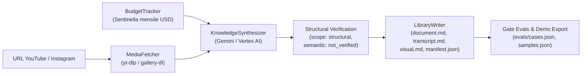

# Architecture Decision Records (ADR) & Master Task Backlog — kn5

Questa cartella raccoglie gli **Architecture Decision Records (ADR)** e il **Master Task Backlog** di **kn5 — Knowledge Ingestor** (`Noobucodonosor/kn5`).

---

## Indice degli ADR

| ID | Titolo | Stato | Priorità | Autori |
| :--- | :--- | :--- | :--- | :--- |
| **[ADR-0001](./0001-architettura-core-kn5.md)** | Architettura Core — Ingestione Media, Pacchetti Auditable a 4 Artefatti, Sentinella Budget e Verifica Strutturale | Accettato | P1 — Alta | Dany |

---

## Diagramma Architetturale del Sistema

---

## Master Task Backlog

| Task ID | Issue | ADR | Titolo Task | File Coinvolti | Priorità | Assegnatari |
| :--- | :--- | :--- | :--- | :--- | :--- | :--- |
| **TASK-KN5-01** | `#1` | [ADR-0001](./0001-architettura-core-kn5.md) | Comando `export-demo` (`samples.json`) e vista Manifest di verifica strutturale nella preview | `main.py`, `tests/test_export_demo.py`, `gh-pages` | **P1 — Alta** | Dany |
| **TASK-ADR-01** | `#2` | [ADR-0001](./0001-architettura-core-kn5.md) | Inizializzare `AGENTS.md`, `docs/adr/` e template Issue/PR | `AGENTS.md`, `docs/adr/`, `.github/` | **P1 — Alta** | Dany |
| **TASK-CI-01** | `#3` | [ADR-0001](./0001-architettura-core-kn5.md) | Aggiungere workflow GitHub Actions CI (`unittest` + `adr-pre-release`) | `.github/workflows/ci.yml`, `.github/workflows/adr-pre-release.yml` | **P1 — Alta** | Dany |
